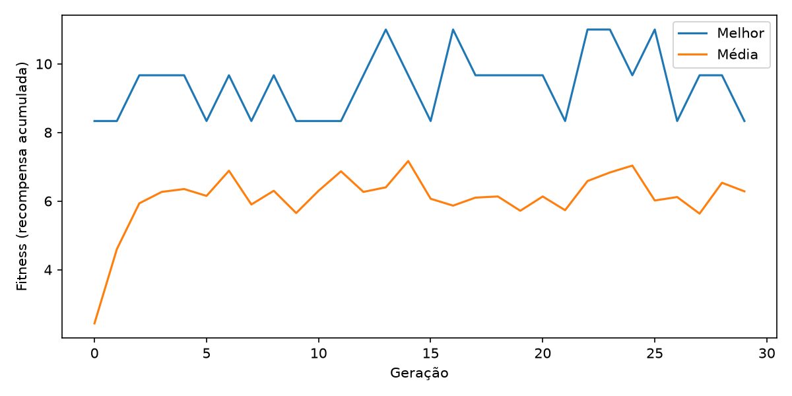
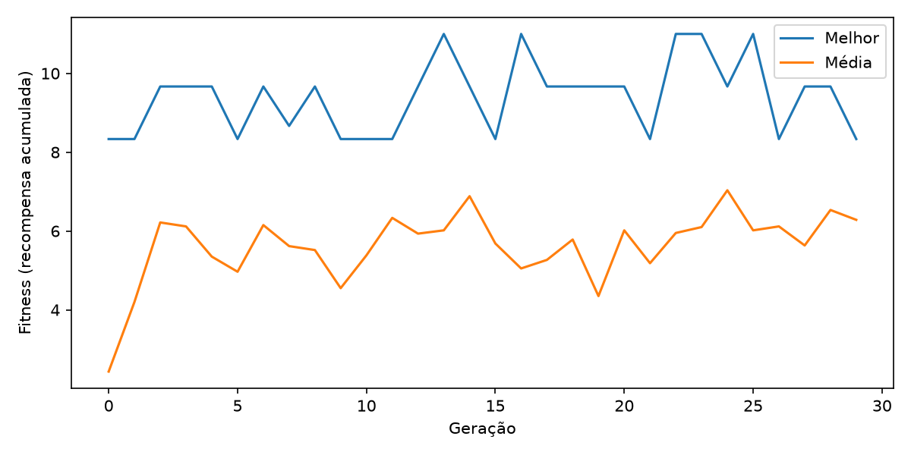
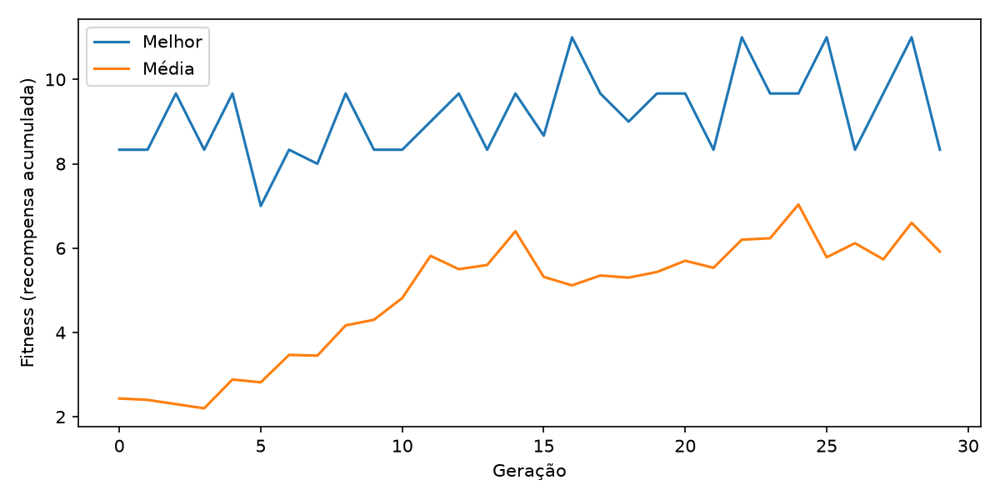

# Neuroevolução no Breakout (Atari) — Atividade 2

Treinamento de uma rede neural artificial para jogar **Breakout** usando **neuroevolução** (algoritmo genético + perceptron multicamada), conforme o enunciado da atividade.

---

## Ambiente e observação

| Item | Valor |
|------|-------|
| Ambiente | `ALE/Breakout-v5` (Arcade Learning Environment) |
| Observação | **RAM** (`obs_type="ram"`) — vetor de 128 bytes |
| Ações | 4: `NOOP`, `FIRE`, `RIGHT`, `LEFT` |
| Recompensa | Pontos acumulados quebrando tijolos (1 ponto/tijolo) |
| Limite de passos por episódio | 8000 |
| Episódios por indivíduo | 3 (fitness = média das 3 partidas) |

---

## Arquitetura do agente

| Camada | Neurônios | Ativação |
|--------|-----------|----------|
| Entrada | 128 (RAM, normalizada para `[-0.5, 0.5]`) | — |
| Oculta | 32 | `tanh` |
| Saída | 4 (uma por ação) | `argmax` |

- Inicialização dos pesos: **He** (`sqrt(2/n)`), bias = 0.
- Ação `FIRE` é forçada no início e após perder uma vida (regra do ambiente).

---

## Configuração do algoritmo genético

| Parâmetro | Valor |
|-----------|-------|
| Tamanho da população | 20 |
| Número de gerações | 30 |
| Estratégia de seleção | **Truncamento** — apenas a metade superior da população (10 pais) é usada para gerar filhos |
| Elitismo | **3 indivíduos** preservados sem mutação a cada geração |
| Seed base | 42 (com variação automática por geração/indivíduo para evitar overfitting a um único episódio) |

### Mutação

Cada gene (peso ou bias) sofre mutação com probabilidade `taxa`, recebendo um ruído gaussiano de desvio `intensidade`. A intensidade **decai 80% ao longo do treino** (começa em `intensidade` e termina em `0.2 × intensidade`), equilibrando exploração no início e explotação no final.

---

## Experimentos

Três configurações de mutação foram comparadas:

| Experimento | Taxa de mutação | Intensidade inicial |
|-------------|-----------------|---------------------|
| **A** | 1% | 0.05 |
| **B** | 10% | 0.20 |
| **C** | 40% | 0.50 |

### Como executar

```bash
# Instalar dependências
pip install -r requeriments.txt

# Rodar um experimento específico
python main.py --experimento A
python main.py --experimento B
python main.py --experimento C

# Ou os três em sequência
python main.py --experimento todos
```

Opções úteis:

```
--populacao N     tamanho da população (padrão: 20)
--geracoes N      número de gerações (padrão: 30)
--elite N         indivíduos preservados por elitismo (padrão: 3)
--seed N          seed base (padrão: 42)
--visualizar      exibe o melhor agente ao final do treino
--acompanhar      exibe todas as partidas durante o treinamento
```

Os resultados são salvos em `resultados/<A|B|C>/`:
- `fitness.csv` — melhor, média e pior fitness por geração
- `fitness.png` — gráfico de evolução do fitness
- `diagnostico.csv` — métricas de ações por indivíduo
- `comparacao.csv` — agente aleatório vs. evoluído
- `melhor_agente.npz` — pesos do melhor agente encontrado

---

## Resultados dos três experimentos

| Experimento | Melhor fitness (global) | Fitness médio final (geração 29) | Agente aleatório | Agente evoluído |
|-------------|-------------------------|----------------------------------|------------------|-----------------|
| **A** (1% / 0.05) | 11.0 | 6.28 | 2.0 | 11.0 |
| **B** (10% / 0.20) | 11.0 | 6.28 | 2.0 | 11.0 |
| **C** (40% / 0.50) | 11.0 | 5.92 | 2.0 | 11.0 |

*Fitness = recompensa acumulada média em 3 episódios por indivíduo.*

---

## Gráficos — melhor fitness e fitness médio

#### Experimento A — taxa 1%, intensidade 0.05



#### Experimento B — taxa 10%, intensidade 0.20



#### Experimento C — taxa 40%, intensidade 0.50



---

## Análise: exploração e convergência

### Resumo quantitativo

| Métrica | A (1% / 0.05) | B (10% / 0.20) | C (40% / 0.50) |
|---------|---------------|----------------|----------------|
| Melhor fitness global | 11.0 (geração 13) | 11.0 (geração 13) | 11.0 (geração 16) |
| Média inicial (geração 0) | 2.43 | 2.43 | 2.43 |
| Média final (geração 29) | 6.28 | 6.28 | 5.92 |
| Políticas repetitivas (≥95% uma ação) na geração 29 | 20/20 | 15/20 | 14/20 |
| Ação dominante do melhor agente | LEFT 98.1% | LEFT 71.2% + FIRE 28.8% | LEFT 98.1% |

### Exploração

- A **média** da população sobe de ~2.4 (geração 0) para ~6–7 nos experimentos A e B, indicando que a seleção está funcionando: indivíduos com melhor desempenho estão deixando mais descendentes. O experimento C sobe mais devagar (média ~2.4 até a geração 5) e termina levemente inferior (5.92), mostrando que a **mutação muito intensa (40%) degrada a qualidade média** ao quebrar indivíduos bons mais rápido do que a seleção consegue reconstruí-los.
- O **pior** indivíduo também melhora (de 0 para ~3–4 em A/B), mostrando que a massa da população acompanha a evolução.
- O experimento **B apresenta a maior diversidade de políticas**: além do "sempre LEFT", surgem indivíduos com misturas de `NOOP` alto (até 90%), `RIGHT` (até 64%) e `FIRE` — a mutação intermediária (10%) gera variação suficiente sem destruir a estrutura dos pais. Já em **A** (1%), quase toda a população convergiu para a mesma política degenerada (20/20 repetitivos), e em **C** (40%) as políticas variam muito de geração para geração, sem estabilizar.
- A **decaimento da intensidade de mutação** permite exploração ampla no início e refino fino no final do treino.
- A estratégia de **seed variável** por geração/indivíduo evita que a evolução se especialize em um único episódio, forçando o algoritmo a encontrar políticas mais robustas.

### Convergência

- O **melhor** fitness atinge 11 já nas gerações 13 (A e B) ou 16 (C) e **não melhora significativamente** até a geração 30 — sinal claro de **convergência prematura** para um ótimo local. A partir da geração ~13, o "melhor" oscila entre 8.3 e 11.0 sem tendência de alta, e o fitness de comparação final (11.0) fica idêntico nos três experimentos.
- O diagnóstico de ações mostra que o agente evoluído aprende uma política **degenerada**: o melhor agente de A e C joga **~98% LEFT** (o paddle vai para a esquerda e fica lá), enquanto o melhor de B mistura **LEFT 71% + FIRE 29%**. Nenhum dos três usa `RIGHT` de forma relevante nem reage à posição da bola. Isso é suficiente para quebrar alguns tijolos quando a bola vem pela direção correta, mas está longe de uma política competente de Breakout (teto realista com RAM estaria na casa de centenas de pontos).
- **Todos os três experimentos chegaram ao mesmo platô (~11)**, com curvas de média muito parecidas nas gerações finais. Isso sugere que o espaço de busca definido pela RAM de 128 bytes com rede 128→32→4 e apenas 30 gerações/população 20 é o limitante — a taxa de mutação, isoladamente, não foi capima de romper o ótimo local.

### Conclusão comparativa

- **A (1% / 0.05):** exploração baixa, convergência rápida para uma única política (20/20 repetitivos). Eficiente para refinar, mas pobre para descobrir comportamentos novos.
- **B (10% / 0.20):** melhor equilíbrio entre exploração e explotação — maior diversidade de políticas (15/20 repetitivos, com indivíduos usando NOOP/RIGHT) mantendo o mesmo melhor fitness. Recomendado como configuração base.
- **C (40% / 0.50):** mutação destrutiva — média mais baixa, oscilação forte entre gerações, e o melhor só aparece mais tarde (geração 16). A intensidade decaída salva o final, mas o dano inicial é visível.

### Possíveis melhorias

- Aumentar população (ex: 40–50) e gerações (ex: 100+).
- Usar observação em **imagem** (frames RGB) em vez de RAM, ou reduzir a RAM aos bytes realmente relevantes para o estado do jogo.
- Adicionar operador de **crossover** além da mutação (atualmente filhos são apenas mutações de um único pai).
- Avaliar cada indivíduo em mais episódios (ex: 5–10) para fitness menos ruidoso.
- Explorar pré-processamento da RAM (ex: extrair posições da bola e do paddle).
- Introduzir pressão seletiva contra políticas degeneradas (ex: bônus de fitness para indivíduos com diversidade de ações ou que sobrevivem mais tempo).
